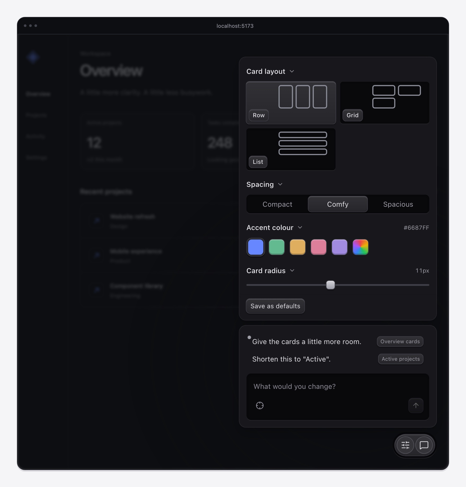

# Isotone

Point at what you want changed. Let your coding agent take it from there.

Pin elements in your running app, leave feedback, and compare design variants.
Notes stay in your project with the route, viewport, and element references your
agent needs. No account, database, or hosted service.



## Start

Run in the project you want to review:

```sh
npm install -D isotone
npx isotone init --yes
```

The second command detects your setup, prints the integration, and adds a short
workflow to `AGENTS.md`. It does not edit your app. Your coding agent can apply
the printed instructions.

Already using the previous package? Follow the [migration guide](docs/migration.md)
to keep your notes, variants, and project setup.

For **Vite**, add the plugin alongside your existing plugins:

```ts
import { defineConfig } from 'vite';
import { iteration } from 'isotone/vite';

export default defineConfig({
  plugins: [/* your framework plugin */, iteration()],
});
```

Works with any Vite framework. The panel brings its own React runtime and is
only injected by the development server.

For **any other dev server**, run `npx isotone serve` and add this to your
development HTML:

```html
<script src="http://127.0.0.1:4123/isotone.js" defer></script>
```

[Integration guide](docs/integrations.md) covers route handlers, React embeds,
configuration, and production guards. Node.js 20 or later is required.

## The loop

1. Open Feedback with **⌘/Ctrl + Shift + .** Write a note, pin elements, and send.
2. Your agent reads `npx isotone --json`, makes the change, and runs
   `npx isotone --done <id>`.
3. Review the result. For alternatives, the agent creates a
   [variant](docs/variants.md) you can switch to in the same page.

Click a saved note to edit it. **Enter** sends; **Shift + Enter** adds a newline.
While selecting elements, click to pin or Tab to a page control and press Space.
Enter or Escape finishes selection. The selected element text stays attached to
the note; closing the panel preserves your draft.

## Themes

The panel follows the rendered page by default. Set `theme` on the Vite plugin,
`mountIteration`, or `IterationPanel`:

```ts
iteration({ theme: 'auto' }); // page background; the default
iteration({ theme: 'system' }); // operating system preference
iteration({ theme: 'light' }); // explicit light, or 'dark'
```

Standalone: `npx isotone serve --theme dark`.
Automatic detection samples background colours; use an explicit theme for
image-led or unusual layered backgrounds. The demo has separate page and panel
theme controls so you can try each combination.

## Updates

The dev server checks public npm in the background, at most once a day while its
cache is retained. A quiet notice offers an exact upgrade command; you or your
agent choose when to run it. Checks fail quietly offline and never send project
content. Use `checkForUpdates: false` to opt out. [Update details](docs/updates.md).

## For maintainers

[Development and contributing](https://github.com/aaroi/isotone/blob/main/docs/development.md)
covers the source, design language, checks, and releases.

MIT.
