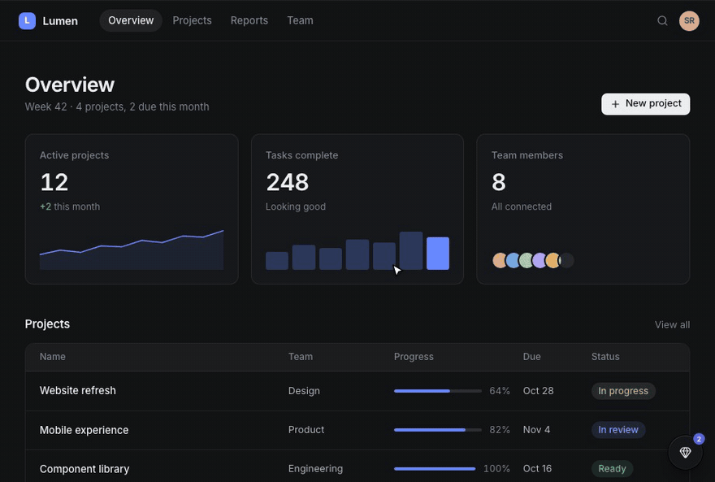
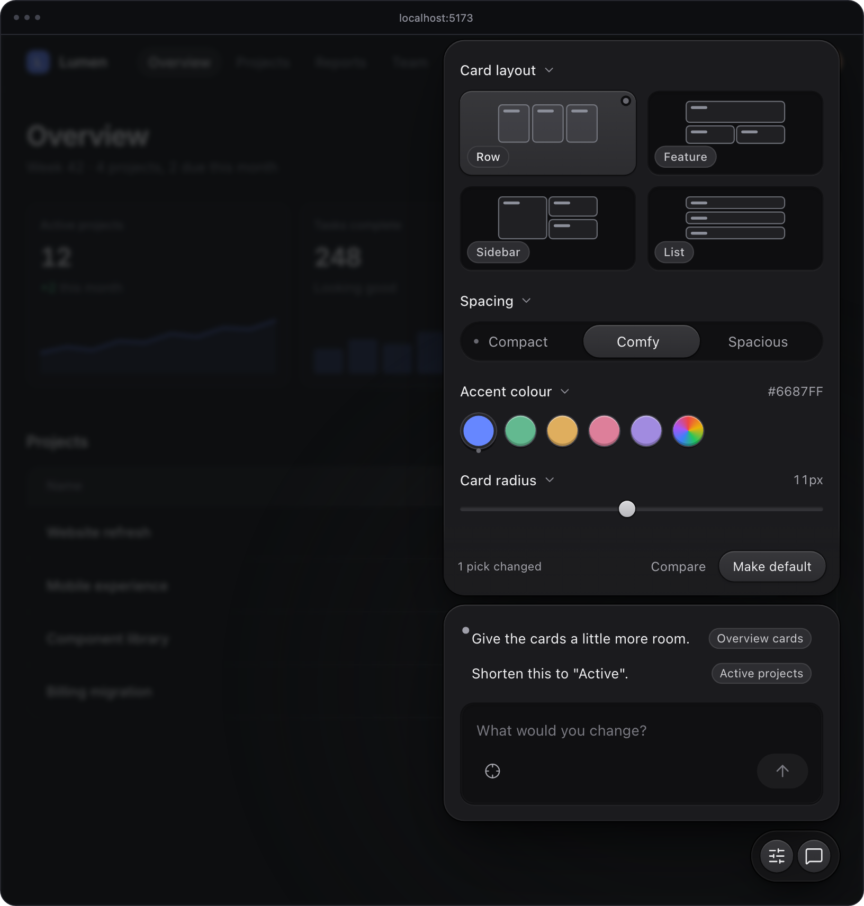

# Isotone

Ask your coding agent for design variants, switch between them in your running
app, and pin feedback to the exact elements you want changed.



Isotone is not an agent, an MCP server or an AI product. It is a small review
panel inside your app during development, working with the coding agent you
already use through a few CLI commands and a JSON file. Nothing reaches
production unless you choose to [collect teammates' feedback](docs/feedback.md)
there, into your own database.

Try it in your browser at [isotone.vercel.app](https://isotone.vercel.app). Nothing to install.

## How it works

Ask your agent for variants of anything on the page: a layout, a spacing scale,
a colour, a component. They appear in the panel's Variants tab as thumbnails,
segmented choices, colour swatches or sliders, and switching one updates the
live page. **Make default** files your picks for the agent to apply, or leave feedback
on a single option.

Whether a pick stays in its tab, with a `?v=` link that shares it, or changes every
open tab depends on your setup; `init` says which, and knob values stay in your
browser ([details](docs/variants.md#per-tab-or-shared)).



When something needs changing, open Feedback with **⌘/Ctrl + Shift + .**, click
the elements you mean, write the change and send. Each note is saved to a JSON
file in your project with the page route, the viewport size, and a selector and
the text of every element you pinned.

Your agent reads the notes with `npx isotone --json`, makes the changes, and
closes each note when it's done. The panel marks the note the agent is working
on and updates without a reload, so you can keep adding notes while it works.

Comparing design directions one prompt at a time is slow, and so is describing
UI in words. Element pickers built into agents work only in the agent's own
browser; Isotone works in yours, with any agent that can run a command.

## Get started

Pick one of these ways to start.

### Start with your agent

In your project, give this to Claude Code, Cursor, Codex or any agent that can
run commands:

```text
Set up Isotone (https://github.com/aaroi/isotone) and show me how to try it on the page I'm working on.
```

The agent installs `isotone` as a dev dependency and runs `npx isotone init --yes`,
which prints the setup for your project and a first run: the panel behind your
framework's development check and two real variants of something on that page.
Then it tells you where to look. Switch them
in the panel, pin a note on anything you want changed, then tell the agent to
check your Isotone notes.

### Set it up yourself

```sh
npm install -D isotone
npx isotone init
```

`init` prints the one change to make: on Vite, a plugin line that acts only on
the dev server; elsewhere, a small local server and a script tag that loads only
on localhost. `init --yes` also adds a short `AGENTS.md` section that teaches
your agent the loop. Isotone works only on the machine running the dev server;
the [integration guide](docs/integrations.md) covers every setup and how each
stays out of production. The CLI needs Node.js 22 or later; your app can be
built with anything that serves pages on localhost.

## Blast mode

Ask your agent for a [Blast session](docs/blast.md): for the time you choose, it
keeps picking up, fixing and closing each batch of new notes without another
prompt. Isotone still never runs the agent; it only hands it the notes.

## Collect feedback from teammates

Experimental. The same panel can ship in a staging, preview or production app,
so teammates pin elements and write feedback there, signed with their name. Each
note lands as a row in your own Postgres; no agent is involved, and what you do
with the rows is up to you. It is one route and one mount:

```ts
// app/api/feedback/route.ts
import { feedback } from 'isotone/feedback';
import { postgres } from 'isotone/postgres';

export const POST = feedback({ store: postgres(process.env.DATABASE_URL) });
```

```ts
mountIsotone({ feedback: { endpoint: '/api/feedback', name: user.name } });
```

It works with any hosted Postgres from its connection URL, with a database
client you already have, or with a store of your own. People can edit and
delete what they wrote, and nobody else can. [Collecting feedback](docs/feedback.md)
has the setup, the saved columns and each provider's details.

## Keys

- **⌘/Ctrl + Shift + .** opens Feedback in select mode. With Feedback open, it
  starts select mode again, or finishes it if it's on. Opening Feedback with the
  mouse also starts select mode.
- In select mode: **click** pins or unpins an element, hold **Shift** to use the
  page normally, **Enter** finishes, and **Escape** clears what you pinned.
- After a pin, the note field opens next to the element, ready for typing.
  Once you're done selecting, **Escape** moves it back into the panel.
- **Enter** sends a note; **Shift + Enter** adds a newline.
- Click a saved note to edit it.
- Hold the key under Escape (**`** or **§**), or **Compare** in Variants, to
  see the page with every selector at its default; let go and your picks come
  back.

## Updates

The dev server checks npm for a newer version at most once a day, sending no
project content. When one is out, **Ask agent to update** in the panel files a
note your agent picks up with the others; nothing installs by itself.
`checkForUpdates: false` turns it off ([details](docs/updates.md)).

## For agents and maintainers

Coding agents working in your app follow the [agent guide](docs/agent-guide.md).
[Development and contributing](https://github.com/aaroi/isotone/blob/main/docs/development.md)
covers changing Isotone itself.

MIT.
