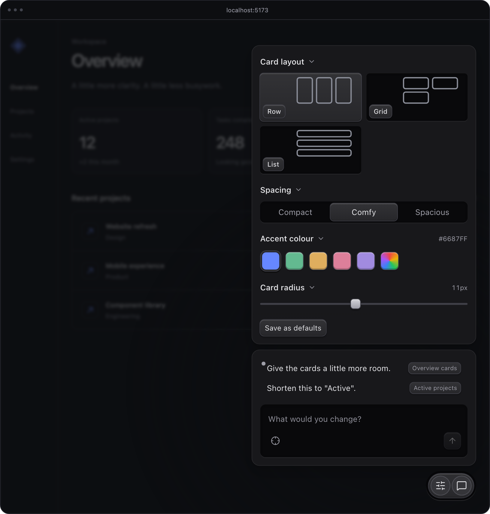

# Isotone

Click an element in your running app, say what should change, and your coding
agent gets the note with the exact element attached.



## How it works

Isotone adds a small panel to your app while it runs in development. Press
**⌘/Ctrl + Shift + .**, click the elements you mean, write the change and send.
Each note is saved to a JSON file in your project with the page route, the
viewport size, and a selector and the text of every element you pinned.

Your agent reads the notes with `npx isotone --json`, makes the changes, and
closes each note when it's done. The panel marks the note the agent is working
on and updates without a reload, so you can keep adding notes while it works.

To compare directions, ask the agent for variants of a component. They appear in
the panel's Variants tab, where you switch between them on the live page and
keep the one you want.

Describing UI to an agent in words is slow, and element pickers built into
agents such as Claude Code only work inside the agent's own browser. Isotone
works in the browser you already use, with any agent that can run a command.

## Add it to a project

```sh
npm install -D isotone
npx isotone init --yes
```

`init` detects your setup, prints the one change to make, and adds a short
section to `AGENTS.md` that teaches your agent the loop. Your agent can apply
the change for you. Nothing is added to production builds.

On **Vite**, the change is one plugin, and it works with any framework:

```ts
import { iteration } from 'isotone/vite';

export default defineConfig({
  plugins: [/* your framework plugin */, iteration()],
});
```

On **any other dev server**, run `npx isotone serve` and add one script tag to
your development HTML:

```html
<script src="http://127.0.0.1:4123/isotone.js" defer></script>
```

The [integration guide](docs/integrations.md) covers Next and other route
handlers, React embeds, themes and production guards. Node.js 20 or later is
required. Coming from the previous package? See the [migration guide](docs/migration.md).

## Keys

**Enter** sends a note and **Shift + Enter** adds a newline. Click a saved note
to edit it. In select mode, click to pin or unpin, hold **Shift** to use the page
normally, and press **Enter** or **Escape** to finish.

## Updates

The dev server checks npm for a newer version at most once a day and shows the
upgrade command in the panel. The check sends no project content and stays quiet
offline. Set `checkForUpdates: false` to turn it off. [Update details](docs/updates.md).

## For maintainers

[Development and contributing](https://github.com/aaroi/isotone/blob/main/docs/development.md)
covers the source, design language, checks and releases.

MIT.
